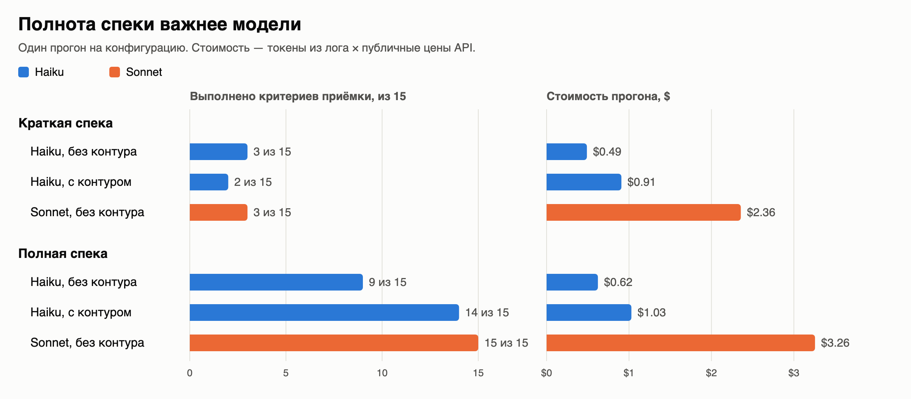

# Спека × модель × контур проверок

Стенд проверяет, может ли в SDD-процессе (spec-driven development) дешёвая модель дать то же качество, что дорогая, и что на это влияет сильнее: выбор модели, полнота спеки или контур автоматических проверок. Агент — Claude Code; задача — раздел фронтенда «Мои клиенты» с таблицей на 10 000 строк; качество измеряется скрытой приёмкой из 15 критериев.



| Модель | Спека | Контур проверок | Выполнено AC | Стоимость прогона | Стоимость одного AC |
|---|---|---|---|---|---|
| Haiku | краткая | нет | 3/15 | $0.49 | $0.16 |
| Haiku | краткая | есть | 2/15 | $0.91 | $0.45 |
| Sonnet | краткая | нет | 3/15 | $2.36 | $0.79 |
| Haiku | полная | нет | 9/15 | $0.62 | $0.07 |
| Haiku | полная | есть | **14/15** | $1.03 | $0.07 |
| Sonnet | полная | нет | **15/15** | $3.26 | $0.22 |

Один прогон на конфигурацию. Стоимость — токены из лога × публичные цены API; прогоны шли по подписке.

## Выводы

1. **Спека важнее модели.** На краткой спеке Sonnet и Haiku выполнили по 3 критерия из 15 и провалили одни и те же 12. Sonnet при этом обошёлся почти в 5 раз дороже: $2.36 против $0.49.
2. **Контур проверок без полной спеки не помогает и стоит дороже.** С краткой спекой Haiku с контуром набрал 2/15 вместо 3/15 и потратил $0.91 вместо $0.49 (110 ходов против 57): проверки помогают довести до зелёного то, что агент написал, но не знают о требованиях, которых нет в спеке. С полной спекой контур поднимает Haiku с 9 до 14 критериев.
3. **Haiku с полной спекой и контуром — 14/15 за треть цены Sonnet** ($1.03 против $3.26). По стоимости одного выполненного критерия это втрое дешевле: $0.07 против $0.22.

## Пример: в плане есть, в коде нет, контур не поймал

Спека требует выравнивать комиссию по правому краю (п. 4.3). Haiku с полной спекой и контуром записал это в свой план:

```markdown
19. **Сумма.** `formatMoney(commissionKopecks)`, правое выравнивание, `textAlign: "right"` в колонке.
```

В коде ячейка осталась без выравнивания:

```tsx
<div key={cell.id} role="cell" className={styles.cell}>
  {flexRender(cell.column.columnDef.cell, cell.getContext())}
</div>
```

`npm run check` и `npm run test:e2e` у агента зелёные: типы, линтер и тесты выравнивание не проверяют, а свои тесты агент пишет по своему коду, а не по плану. Контур подтверждает, что код согласован сам с собой, но не то, что сделано всё задуманное. Это поймала только внешняя приёмка по спеке (AC-02) — единственный критерий, которого этому прогону не хватило до 15/15.

## Ограничения

- **Один прогон на конфигурацию.** Планировалось по три; без них нет разброса, и выводы выше — наблюдения, а не статистически значимый результат.
- **Синтетическая задача.** Одна фича на подготовленной базе с моком бэкенда, без живого API и ревью.
- **Спеку, эталон и приёмку готовил я вместе с Claude Code.** Тесты опираются только на спеку и проходят валидацию (эталон 15/15, голая база 0/15, мутации), но на коде агентов в них нашлись шесть ошибок. Все исправлены, все прогоны переоценены: [список правок](docs/acceptance-changes.md).
- **Время прогона S-brief-off не сравнивать с остальными:** он шёл одновременно с переоценкой приёмки, которая нагружала процессор. На результат приёмки это не влияет.
- Краткую спеку оценивают теми же 15 критериями, что полную: это требования продукта, а краткая спека — их неполное изложение.

## Как запустить

Нужны Node.js 22+ и git.

```sh
(cd base && npm ci && npx playwright install chromium)

# Эталон и приёмка: 15/15 в трёх прогонах подряд
node eval/reference/build.mjs --out /tmp/sdd-reference
node eval/acceptance/run.mjs /tmp/sdd-reference --repeat 3

# Голая база без фичи: 0/15
node eval/reference/build.mjs --bare --out /tmp/sdd-bare
node eval/acceptance/run.mjs /tmp/sdd-bare

# Один прогон агента (нужен Claude Code и токен подписки, см. eval/harness/README.md)
node eval/harness/run.mjs --pilot H-full-on    # → eval/results/_pilot/, в сводку не входит
node eval/harness/summarize.mjs                # → eval/results/summary.md
```

## Что где

| Путь | Что это |
|---|---|
| [spec/](spec/) | Краткая и полная спека, история полной |
| [base/](base/) | Базовый проект без фичи и правила для агента |
| [eval/acceptance/](eval/acceptance/) | Скрытая приёмка AC-01…AC-15 |
| [eval/reference/](eval/reference/) | Эталонная реализация (для валидации приёмки) |
| [eval/harness/](eval/harness/) | Харнесс прогонов |
| [eval/results/](eval/results/) | По каждому прогону: `result.json`, план агента, дифф, скриншоты; [сводка](eval/results/summary.md) |
| [docs/methodology.md](docs/methodology.md) | Методика: переменные, изоляция, приёмка, метрики |
| [docs/acceptance-changes.md](docs/acceptance-changes.md) | Все правки приёмки: что было, почему это ошибка теста, как проверено |
| [docs/build-log.md](docs/build-log.md) | Журнал сборки стенда |

## Лицензия

[MIT](LICENSE)
